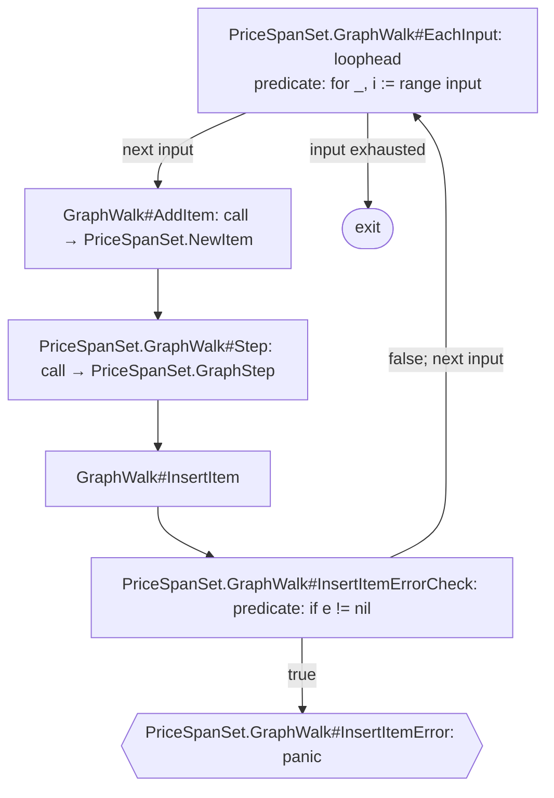
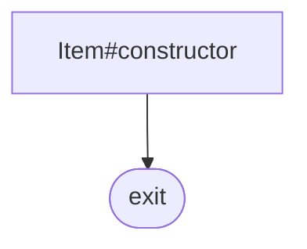
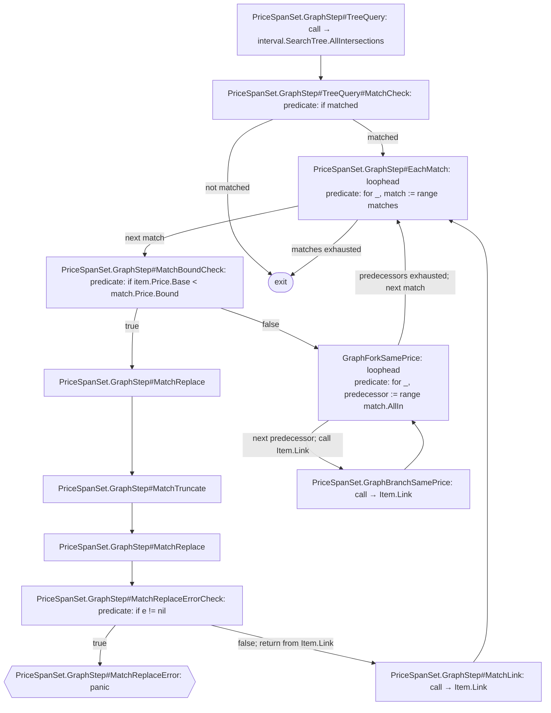
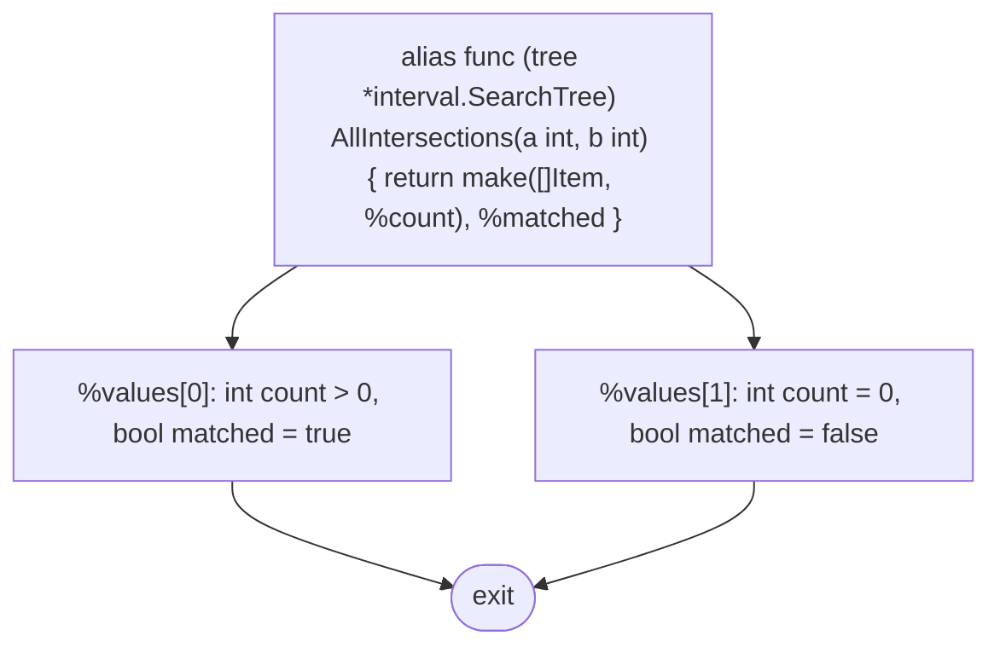
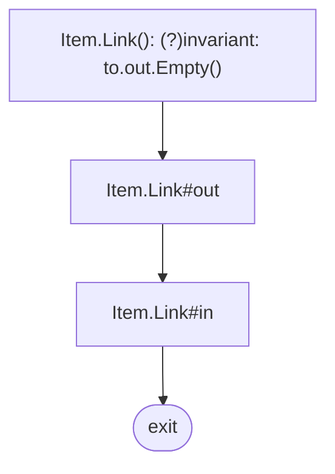

# DAG control-flow graphs

These graphs are derived from annotations in `internal/profit-triplet/dag.go` and the callee summaries present in that file. Unannotated Go statements are tacit: they are not nodes, but their control-flow effect is represented by arrows between annotated nodes.

The source annotations are interpreted by intent, not validated as strictly conforming to `symbolic-abstraction.bnf`. Some tags omit `: `, use comma-separated labels, include function signatures, or contain multiple `#` locators.

Graph-generation conventions are defined in [cfg-generation-rules.md](./cfg-generation-rules.md); these diagrams follow those rules. Each function has a separate graph. A call-site node names its target graph; follow that graph to inspect the callee's control flow.

## `PriceSpanSet.GraphWalk`

## `PriceSpanSet.NewItem`

## `PriceSpanSet.GraphStep`

## `interval.SearchTree.AllIntersections` (summary)

## `Item.Link`

