# DAG control-flow graphs

These graphs are regenerated from the current annotations in
`internal/profit-triplet/dag.go`. Unannotated Go statements are omitted as
nodes; their control-flow effect is represented by arrows between annotated
nodes. Each function or summary has a separate graph. A call-site node names
the graph for its callee; follow that graph to inspect its behavior.

Graph-generation conventions are defined in
[`cfg-generation-rules.md`](../meta/cfg-generation-rules.md). For annotated
predicates, the label is replaced by the corresponding Go condition or loop
header. Calls without a `call` label are not shown as call edges.

## `atomic.Int32.Add`

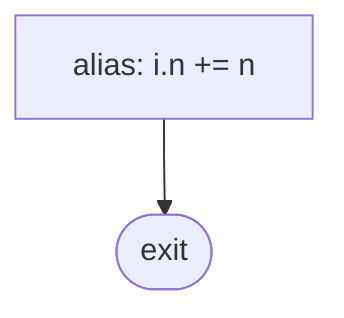

## `vector.Vector.PushBack`

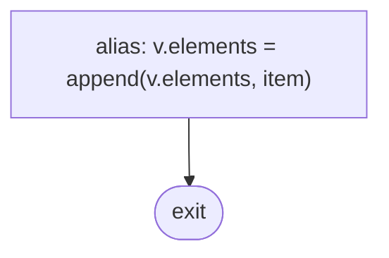

## `vector.Vector.At`

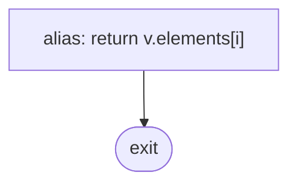

## `vector.Vector.Size`

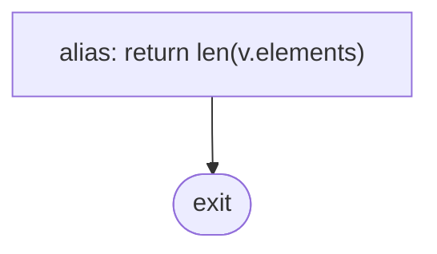

## `vector.Vector.Empty`

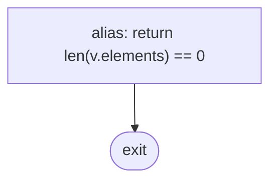

## `vector.NewVector`

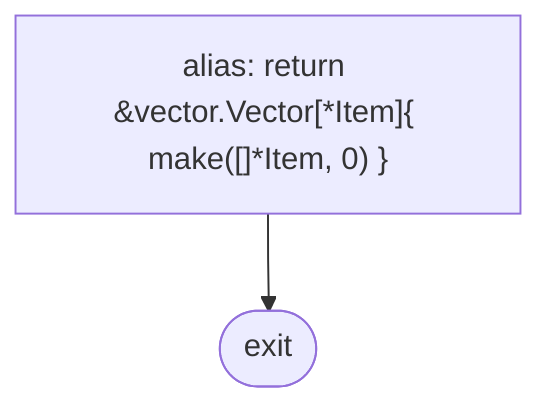

## `interval.SearchTree.AllIntersections`

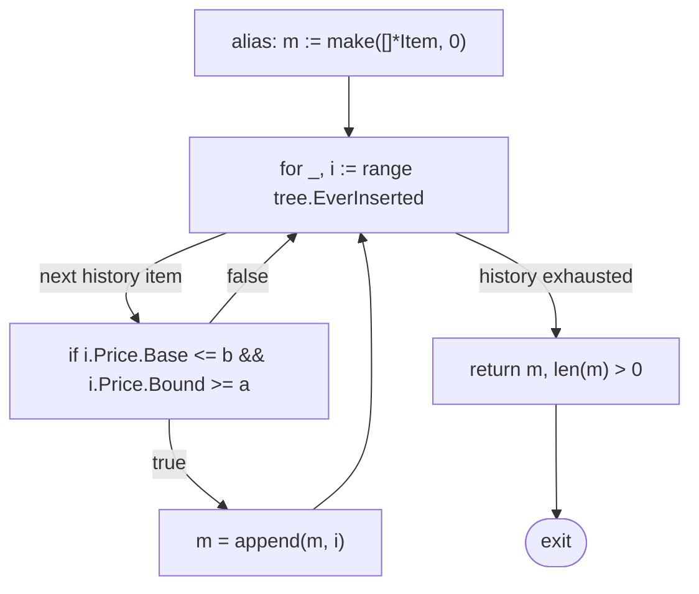

## `NewPriceSpanSet`

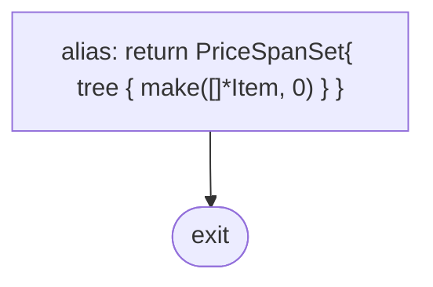

## `PriceSpanSet.NewItem`

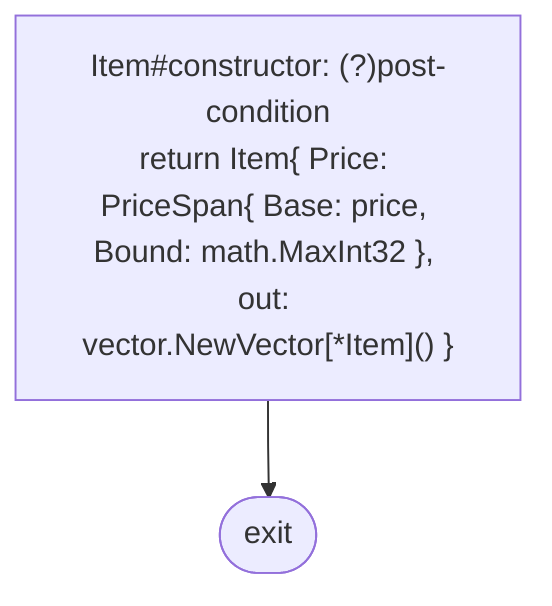

## `Item.Join`

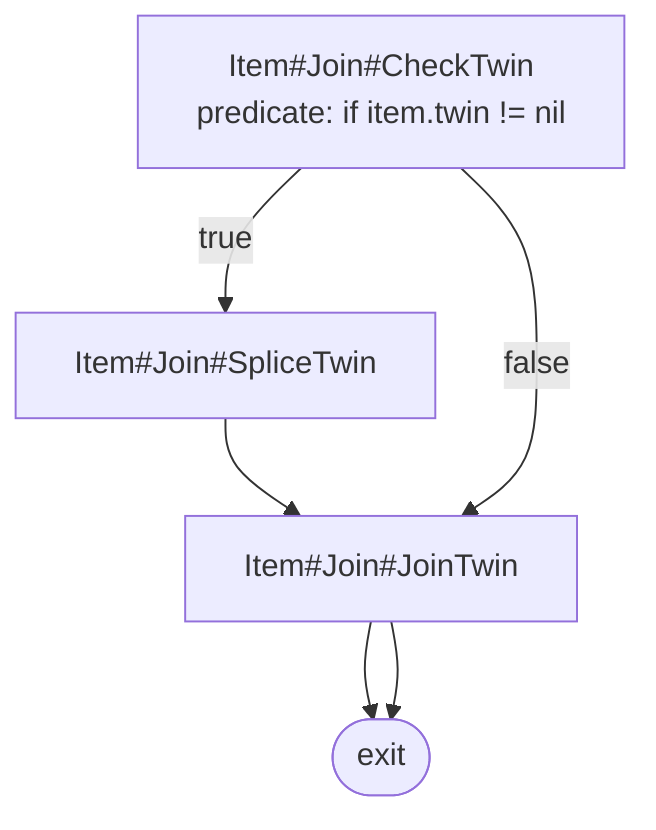

## `Item.AllIn`

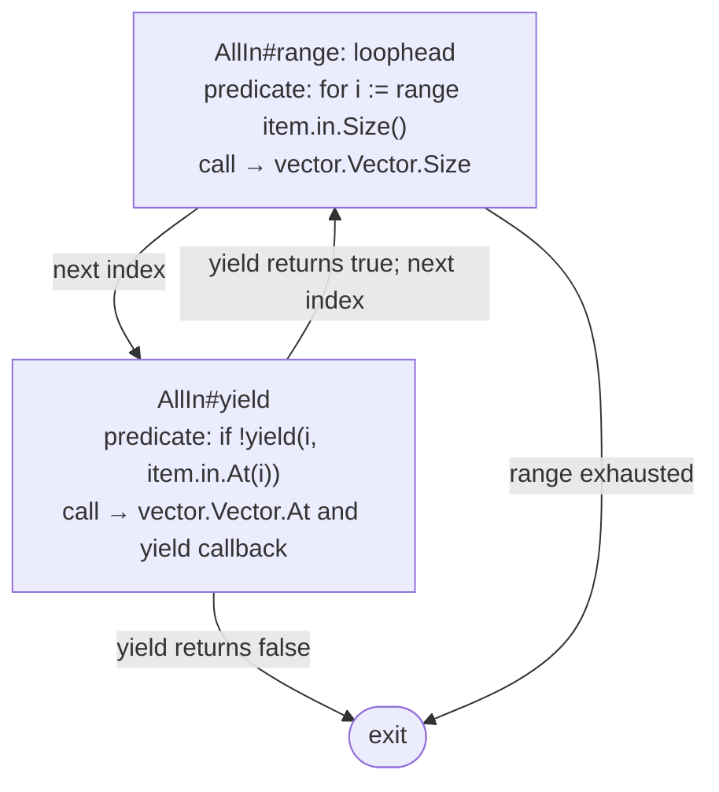

## `Item.Link`

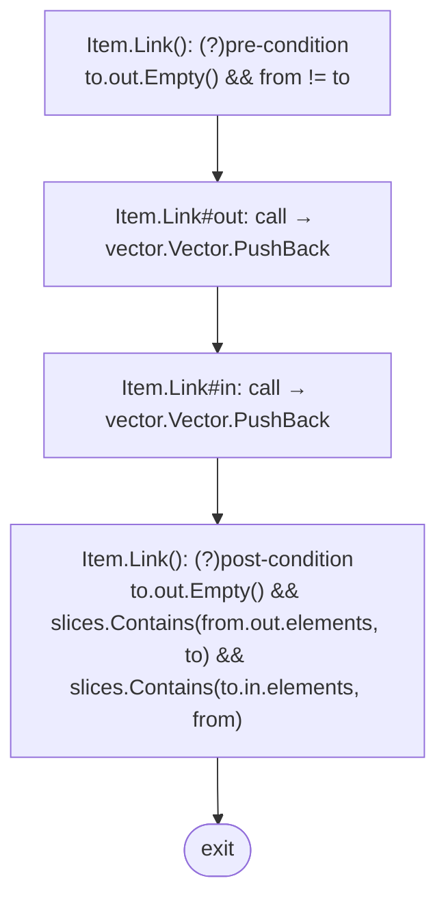

## `PriceSpanSet.GraphWalk`

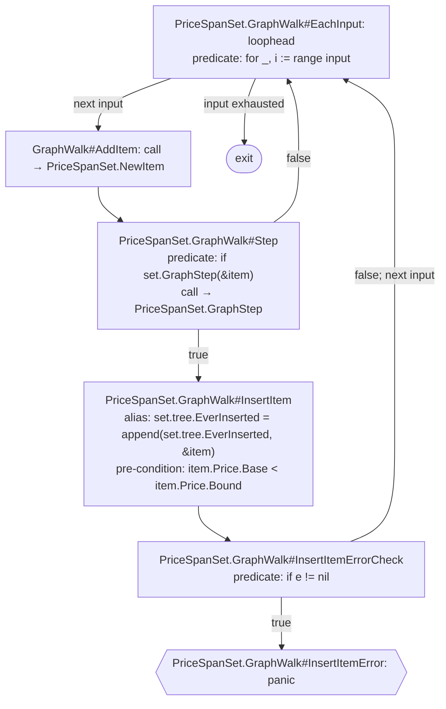

## `PriceSpanSet.GraphStep`

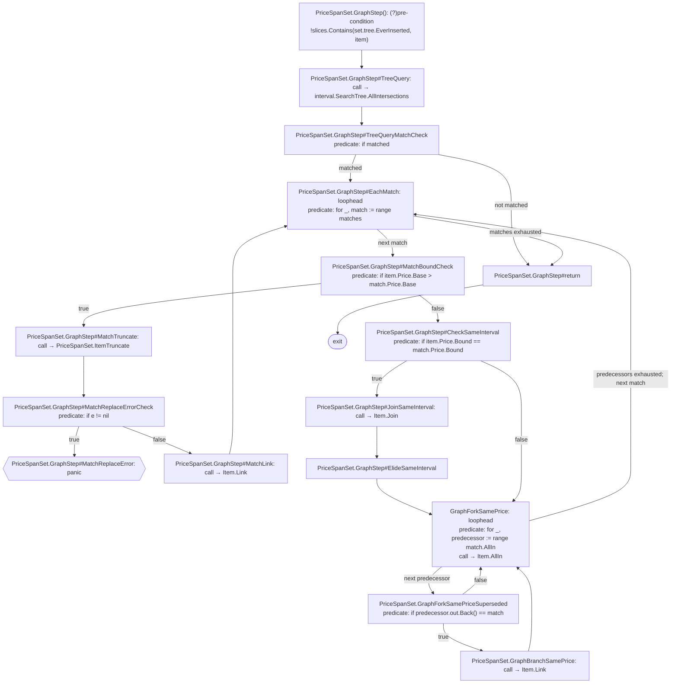

## `PriceSpanSet.ItemTruncate`

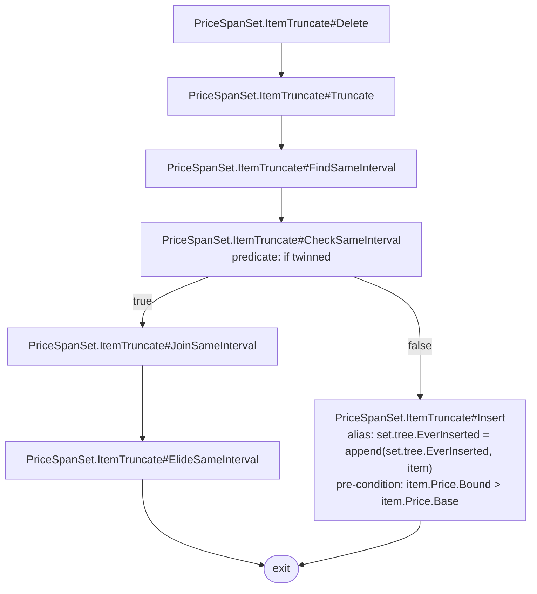
